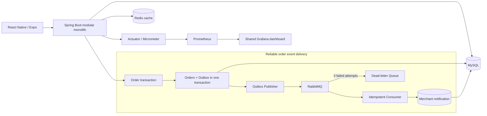

# Scalable Food Marketplace Backend

This project extends the LastCall Eats food-rescue marketplace into a scalable and reliable backend case study. Restaurants and bakeries sell end-of-day surplus food at a discount, while customers browse, reserve, pay, and collect orders.

This version extends the original application with concurrency-safe inventory, indexed database pagination, Redis caching, reliable RabbitMQ messaging, an idempotent notification consumer, and production-style observability.

## Architecture



The backend is a Maven multi-module application. Business domains remain isolated in separate modules while `lastcall-api` assembles one runnable service.

| Module | Responsibility |
|---|---|
| `lastcall-common` | Shared responses, exceptions, providers, storage and Redis dependencies |
| `lastcall-auth` | JWT authentication and authorization |
| `lastcall-user` | User profiles, avatars and favourites |
| `lastcall-merchant` | Merchant profiles and dashboard |
| `lastcall-product` | Product templates, daily listings, indexed browse query and cache |
| `lastcall-order` | Inventory reservation, order lifecycle, Outbox, RabbitMQ and notifications |
| `lastcall-payment` | Stripe payment intents and webhooks |
| `lastcall-review` | Ratings and community posts |
| `lastcall-api` | Application entry point, configuration and Actuator endpoints |
| `lastcall-frontend` | React Native application built with Expo |

## Reliability and scalability work

### Concurrency-safe inventory

Inventory uses a conditional atomic database update inside the order transaction:

```sql
UPDATE product_listing
SET remaining_quantity = remaining_quantity - 1
WHERE id = ? AND is_available = TRUE AND remaining_quantity > 0;
```

In the controlled test, 100 concurrent buyers competed for 10 units. Before the fix, the system created 17 orders and returned 58 HTTP 500 deadlock responses. After the fix, exactly 10 orders succeeded, stock reached 0, and the other 90 requests received normal business rejections with no HTTP 500 errors. See the [concurrency report](docs/concurrency-results/304ca71f14c5/report.md).

### Database query optimization

The browse endpoint now uses database pagination, a DTO projection, a three-table Join, and the composite index `(is_available, created_at DESC, id DESC)`. A derived table selects one page before joining templates and merchants.

| Browse implementation | SELECT/request | Rows returned | P95 | Requests/s |
|---|---:|---:|---:|---:|
| Original unbounded endpoint | about 10,004 | 10,000 | 510.97 ms | 1.94 |
| Indexed pagination + Join | 1 | 20 | 2.52 ms | 510.60 |
| Redis Cache-Aside | 0 on hit | 20 | 1.58 ms | 790.77 |

The final cache experiment completed 23,724 requests with a 0% HTTP failure rate and only one MySQL SELECT. See the [query optimization](docs/query-optimization/index-optimization.md) and [cache benchmark](docs/cache/cache-aside.md).

### Redis Cache-Aside

Browse pages use `page + size` as the Redis key and expire after 60 seconds. Cache misses query MySQL and populate Redis. Product creation, removal, and successful order commits invalidate browse keys after the database transaction commits. Redis failures use a fail-open path and fall back to MySQL.

### Reliable asynchronous order events

Creating an order also inserts an `ORDER_CREATED` event into `outbox_event` in the same MySQL transaction. A scheduled Publisher atomically claims records, sends persistent messages, waits for RabbitMQ Publisher Confirm, and retries failed deliveries with bounded exponential backoff.

The delivery guarantee is **at least once**. The notification Consumer therefore records `(event_id, consumer_name)` in `processed_event` and creates the merchant notification in one transaction. Duplicate messages are acknowledged without creating duplicate notifications. Consumer failures are retried three times, then rejected to a DLX and stored in a DLQ.

See [Transactional Outbox](docs/messaging/transactional-outbox.md) and [idempotent consumer](docs/messaging/idempotent-merchant-notification-consumer.md).

### Observability

Spring Boot Actuator and Micrometer expose dependency health and Prometheus-compatible metrics:

- Browse latency histograms split by Redis cache hit and miss
- Browse request, failure, and cache-result counters
- Outbox publication success and failure counters
- Consumer success, duplicate and failure-attempt counters
- Current `PENDING`, `PROCESSING`, and `PUBLISHED` Outbox gauges
- `ORDER_CREATED` end-to-end latency histogram
- MySQL, Redis and RabbitMQ health indicators
- Event logs correlated by `eventId`, `orderId`, and `merchantId`

The repository includes a provisioned Prometheus and Grafana stack. Its shared dashboard gives the
React Native team a time-series view of backend P50/P95/P99 latency, throughput, failures, Redis
cache effectiveness, and asynchronous order-event health. See the
[backend latency dashboard guide](docs/observability/backend-latency-dashboard.md) and the
[messaging observability report](docs/messaging/observability.md).

Run the Spring Boot application with the `dev` profile on port 8080, then start the dashboard:

```bash
docker compose -f observability/docker-compose.yml up -d
```

Open `http://localhost:3000/d/lastcall-backend-latency`. Prometheus is available at
`http://localhost:9090` and scrapes the backend every five seconds.

## Tech stack

- Java 21, Spring Boot 3.2.5, Spring Data JPA, Spring Security and JWT
- MySQL, Redis 7, RabbitMQ 3.13
- Spring AMQP, Spring Retry, Actuator, Micrometer and Prometheus registry
- Stripe Java SDK and MinIO
- React Native, Expo and TypeScript
- Maven multi-module build, JUnit 5, Mockito, H2, Python verification scripts and k6

## Run the scalable baseline locally

Prerequisites: Java 21, MySQL, Docker, Python 3 and Node.js 18+.

Create a fresh isolated database. The initializer refuses to reset an existing baseline database:

```bash
python3 scripts/baseline/init_db.py
```

Create or start Redis and RabbitMQ using the commands in the [Redis setup](docs/cache/redis-environment.md) and [RabbitMQ setup](docs/messaging/rabbitmq-environment.md). Existing containers can be started with:

```bash
docker start lastcall-redis
docker start lastcall-rabbitmq
```

Build, test and run:

```bash
JAVA_HOME=$(/usr/libexec/java_home -v 21) ./mvnw test
JAVA_HOME=$(/usr/libexec/java_home -v 21) ./mvnw -pl lastcall-api -am package -DskipTests
JAVA_HOME=$(/usr/libexec/java_home -v 21) java -jar lastcall-api/target/lastcall-api-0.0.1-SNAPSHOT.jar --spring.profiles.active=baseline
```

The baseline API listens on `http://127.0.0.1:8081`.

| Endpoint | Purpose |
|---|---|
| `GET /api/products/browse?page=0&size=20` | Paginated cached product browse |
| `GET /actuator/health` | Application and dependency health |
| `GET /actuator/metrics` | Available Micrometer metric names |
| `GET /actuator/prometheus` | Prometheus scrape output |
| `GET /swagger-ui.html` | API documentation |

Run the repeatable checks while the backend is running:

```bash
python3 scripts/baseline/smoke_order.py
python3 scripts/messaging/verify_notification_api.py
python3 scripts/messaging/check_observability.py
```

### Frontend

```bash
cd lastcall-frontend/lastcall-app
npm install
npm run dev
```

The phone running Expo Go and the development machine must use the same network.

## Test accounts

All seeded accounts use password `111111`.

| Role | Email | Name |
|---|---|---|
| User | `alice@example.com` | Alice |
| User | `bob@example.com` | Bob |
| Merchant | `bakery@example.com` | Golden Bakery |
| Merchant | `sushi@example.com` | Sakura Sushi |
| Merchant | `cafe@example.com` | Brew & Bite Cafe |

Stripe test payment method: `pm_card_visa`.

## Documentation

- [Baseline and experiment index](docs/baseline.md)
- [Current query diagnosis](docs/query-optimization/current-query-analysis.md)
- [Database pagination](docs/query-optimization/database-pagination.md)
- [Join projection](docs/query-optimization/join-projection.md)
- [Composite index and final query plan](docs/query-optimization/index-optimization.md)
- [Cache-Aside and performance results](docs/cache/cache-aside.md)
- [Cache invalidation](docs/cache/cache-invalidation.md)
- [RabbitMQ topology](docs/messaging/order-messaging-topology.md)
- [Transactional Outbox](docs/messaging/transactional-outbox.md)
- [Idempotent merchant notification Consumer](docs/messaging/idempotent-merchant-notification-consumer.md)
- [Observability](docs/messaging/observability.md)
- [Resume bullets and interview guide](docs/project-presentation.md)

## Contributors

Weisi Chen · Zhaoming Chen · Chanyuan Liu · Yun Xin · Xinhong Zheng
